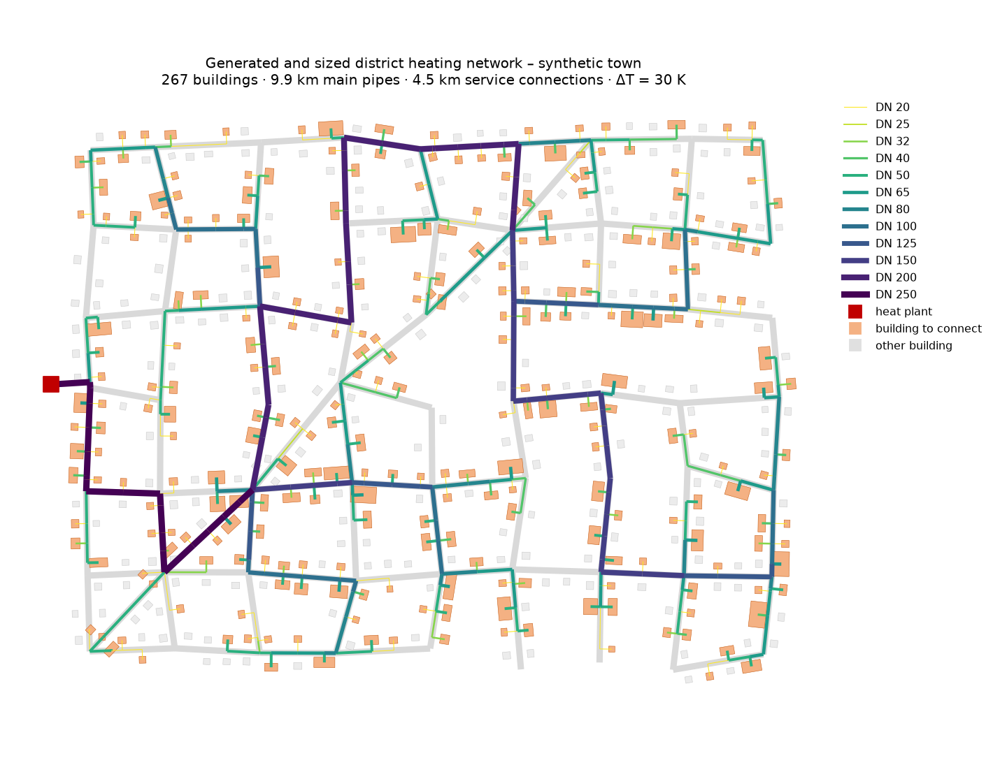
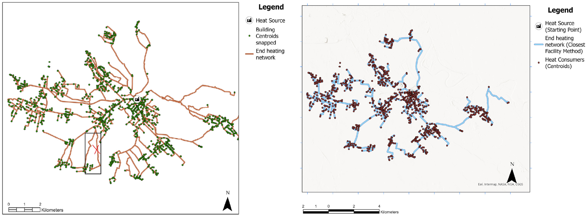
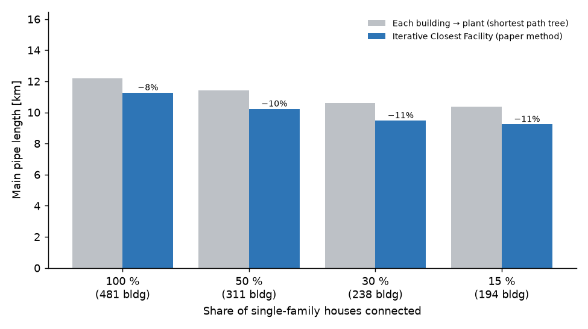
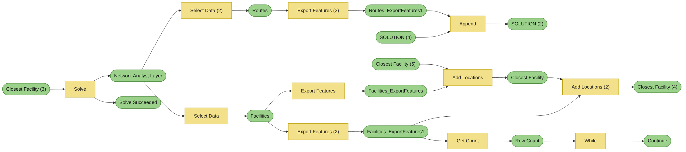

# District Heating Network Generator – ArcGIS Pro & Python

🇬🇧 **English** · 🇵🇱 [Wersja polska](README.pl.md)

[](https://github.com/MalickiJacek/district-heating-network-arcgis/actions/workflows/ci.yml)


[](https://doi.org/10.3390/app14020763)

Automatic first draft of a **district heating network** for a town: pipe routes along the streets from the heat plant to every building, then a **nominal diameter (DN)** for every pipe segment.

The method comes from my peer-reviewed paper:

> Strzalka A., **Malicki J.**, Blachowski J. (2024). *Least-Cost-Path and Closest Facility Analysis for Generating District Heating Networks on a Communal Level.* Applied Sciences 14(2), 763. https://doi.org/10.3390/app14020763

I co-developed the method and built the ArcGIS Pro tools for it (my roles in the paper: methodology, validation). This repository contains:

1. **Network generation** – the iterative Closest Facility method from the paper, as the original ModelBuilder model, an ArcPy script and an open-source Python implementation (networkx, no ArcGIS licence needed).
2. **Pipe sizing** – the next step announced in the paper's conclusions. It was prepared for a follow-up article that was not published; it is shared here.


*Synthetic test town: 267 of 481 buildings connected, 9.9 km of main pipes, DN 20 – DN 250. Generated and sized in 0.1 s.*

## The problem

A planner who wants to supply a district with renewable heat needs a first estimate of the pipe network: where the pipes go, how long they are and how large. Doing this by hand for a thousand buildings takes days. The input data are usually just a street network and building footprints (in Poland: BDOT10k from Geoportal).

## Method 1 – network generation (iterative Closest Facility)

```
connected   = {heat plant}
unconnected = all buildings to connect
while unconnected is not empty:
    shortest street route between any connected point and any unconnected building
    (ArcGIS Network Analyst: Closest Facility, Incidents = connected, Facilities = unconnected)
    keep only the route with the minimum length and add it to the network
    move that building to the connected set
```

Every new building can be supplied from the plant **or from a building that is already connected**, so pipes are shared instead of running each building separately to the plant. In graph theory this is the shortest-path heuristic for the **Steiner tree problem** (Takahashi & Matsuyama 1980).

The paper compared it with Least-Cost-Path Analysis (one path per building to the plant, then merged). LCPA creates parallel and redundant pipes (left); the Closest Facility method gives one tree with *as many pipes as needed* (right):


*Siechnice commune, Wrocław county, 1127 buildings. Left: LCPA with a redundant loop. Right: iterative Closest Facility. Figures 13 and 14 from Strzalka, Malicki & Blachowski (2024), [CC BY 4.0](https://creativecommons.org/licenses/by/4.0/).*

On the synthetic town the iterative method needs 8–11 % less main pipe than the "each building to the plant" baseline:



**The ModelBuilder model** used in the paper ([`model/closest_facility_iteration.png`](model/closest_facility_iteration.png)) – the *While* iterator repeats Solve → keep the shortest route → Append → move the building from Facilities to Incidents:



### Three implementations

| | Where | Speed | Licence |
|---|---|---|---|
| ModelBuilder model | [`model/`](model/) (diagram) | ~220 buildings / hour | ArcGIS Pro + Network Analyst |
| ArcPy script | [`arcpy/01_generate_network.py`](arcpy/01_generate_network.py) | solves only from the newly connected building | ArcGIS Pro + Network Analyst |
| Python package `dhnet` | [`src/dhnet/routing.py`](src/dhnet/routing.py) | seconds (incremental Dijkstra) | open source |

In the model every iteration solves the whole Closest Facility problem again. Adding one connected point can only make routes shorter, so the faster versions solve only from the newly added point and keep the best route found so far for each building – the result is the same.

`dhnet` also has `--from-network`: distances measured from any vertex of the network built so far (the classical Steiner heuristic), not only from the connected buildings as in the paper.

## Method 2 – pipe sizing

1. The load of every building flows along the network from the plant; each segment gets the number of downstream consumers and the sum of their peak loads.
2. The sum is reduced by a **simultaneity factor** g(n) (Winter et al. 2001): 100 houses do not reach their peak at the same moment.
3. Each segment gets the smallest **DN** that can carry its load. Pipe capacities are computed from hydraulics (Darcy–Weisbach + Colebrook, R ≤ 150 Pa/m, v ≤ 3 m/s, ΔT = 30 K, EN 253 steel pipes) – not copied from any design software.

Details, the full capacity table for ΔT 20/30/40/60 K and the limits of the method: [`docs/pipe_sizing.md`](docs/pipe_sizing.md). ModelBuilder version: [`model/pipe_sizing.png`](model/pipe_sizing.png).

## Quick start (Python, no ArcGIS)

```bash
git clone https://github.com/MalickiJacek/district-heating-network-arcgis.git
cd district-heating-network-arcgis
pip install -e ".[dev]"

python -m dhnet --streets data/sample/Streets.shp \
                --buildings data/sample/Buildings.shp \
                --source data/sample/HeatSource.shp --out output
```

```
Pipe length by DN [m]:
pipe_type    main  service  plant   total
dn
20          838.0   2135.0    0.0  2973.0
50         1694.0    925.0    0.0  2619.0
...
250         584.0      0.0   60.0   644.0
```

Outputs: `output/district_heating.gpkg` (layers `pipe_segments`, `pipes_by_dn` – open in QGIS or ArcGIS Pro) and `pipe_lengths_by_dn.csv` (bill of quantities).

| Option | Default | |
|---|---|---|
| `--where` | `connect == 1` | which buildings to connect (pandas query) |
| `--load-field` | `peak_kw` | peak heat load per building [kW] |
| `--delta-t`, `--max-dp`, `--max-v` | 30 K, 150 Pa/m, 3 m/s | sizing parameters |
| `--from-network` | off | classical Steiner heuristic |

**ArcGIS Pro:** see [`arcpy/README.md`](arcpy/README.md).

## Repository structure

```
├── src/dhnet/          routing.py (network generation), sizing.py (DN), pipeline.py, CLI
├── arcpy/              ArcPy versions of the two ModelBuilder models
├── model/              ModelBuilder diagrams (.png + Mermaid source)
├── data/sample/        synthetic town (EPSG:2180): streets, 481 buildings, heat plant
├── scripts/            generate_synthetic_town.py, make_figures.py
├── docs/               pipe_sizing.md, figures
└── tests/              pytest: Steiner heuristic, snapping, hydraulics, sizing
```

## Data

The sample data are **synthetic** (`scripts/generate_synthetic_town.py`): a street grid with building types (single-family, multi-family, public) and assumed peak loads. The case study in the paper used open data from Geoportal.gov.pl (BDOT10k) for the Siechnice commune.

## Tests

```bash
pytest -q
```

13 tests, among others: the iterative method gives a shorter network than routing every building separately, routes never pass through other buildings, the result is a tree that reaches every building, the largest load sits at the plant, pressure loss matches a hand calculation, capacity grows with DN and is linear in ΔT.

## Tech stack

**GIS:** ArcGIS Pro · ModelBuilder · ArcPy · Network Analyst (Closest Facility) · QGIS
**Python:** networkx · Shapely 2 · GeoPandas · pandas · Matplotlib · pytest · GitHub Actions

## Author

**Jacek Malicki** – GIS developer · [LinkedIn](https://www.linkedin.com/in/jacek-malicki-85b04a27b) · [GitHub](https://github.com/MalickiJacek)

The ModelBuilder models are my work from the research project (funded by the National Science Centre, Poland, grant 2023/07/X/ST8/00534). The open-source Python version, the completed ArcPy loop, the synthetic data and this documentation were prepared with AI assistance (Claude).

## How to cite

See [`CITATION.cff`](CITATION.cff) or the paper reference above.

## License

Code: [MIT](LICENSE). Paper figures: CC BY 4.0, © the authors.
