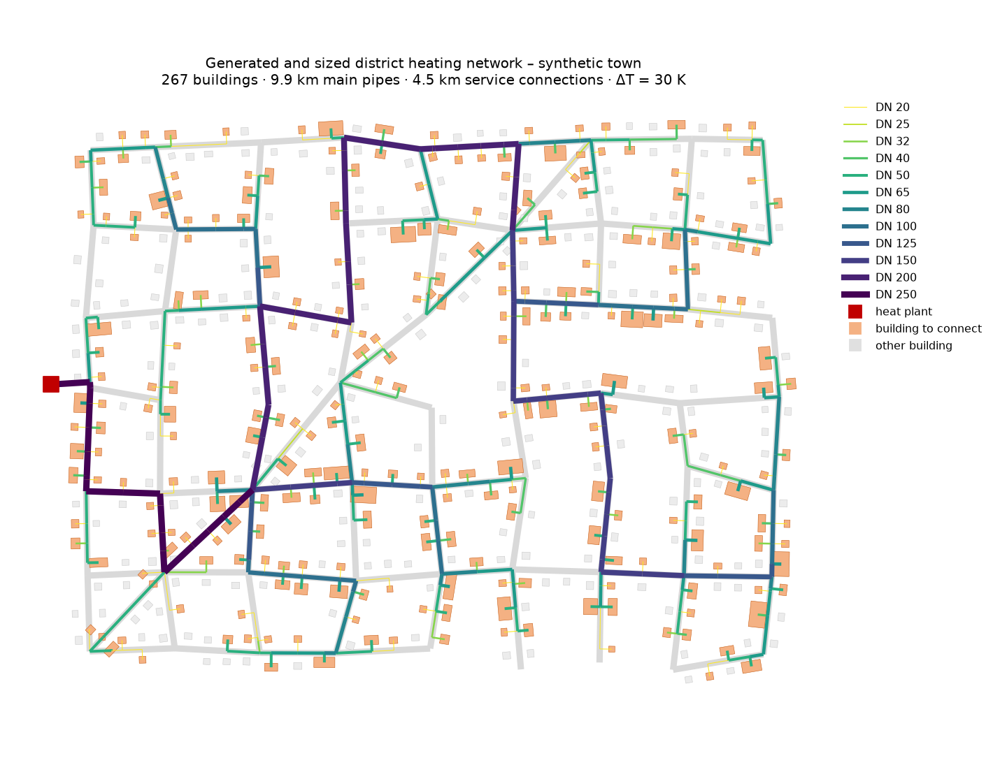
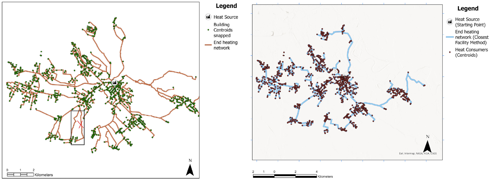
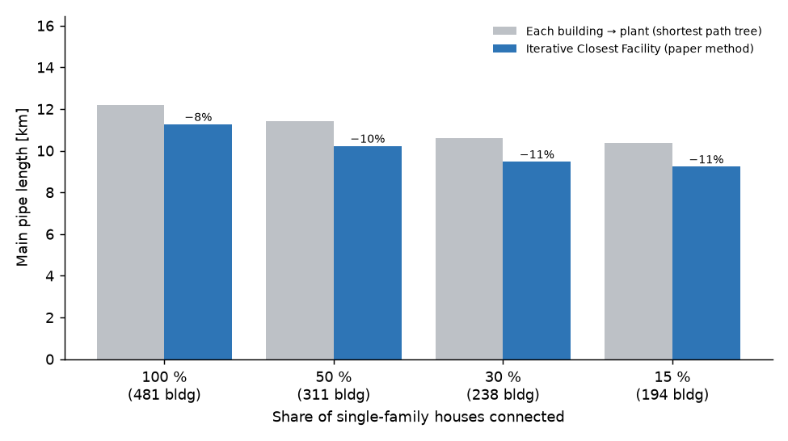
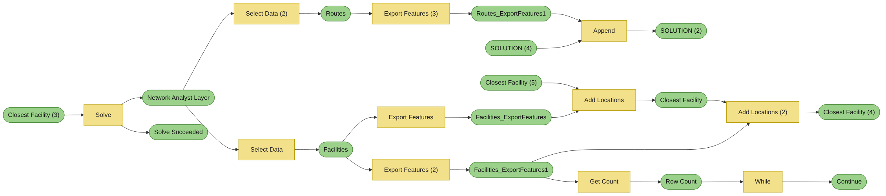

# Generator sieci ciepłowniczej – ArcGIS Pro i Python

🇬🇧 [English version](README.md) · 🇵🇱 **Polski**

[](https://github.com/MalickiJacek/district-heating-network-arcgis/actions/workflows/ci.yml)


[](https://doi.org/10.3390/app14020763)

Automatyczny pierwszy szkic **sieci ciepłowniczej** dla miejscowości: przebieg rur wzdłuż ulic od źródła ciepła do każdego budynku, a następnie **średnica nominalna (DN)** dla każdego odcinka.

Metoda pochodzi z mojej recenzowanej publikacji:

> Strzalka A., **Malicki J.**, Blachowski J. (2024). *Least-Cost-Path and Closest Facility Analysis for Generating District Heating Networks on a Communal Level.* Applied Sciences 14(2), 763. https://doi.org/10.3390/app14020763

Współtworzyłem metodę i zbudowałem do niej narzędzia w ArcGIS Pro (moje role w artykule: metodologia, walidacja). Repozytorium zawiera dwa moduły:

1. **Generowanie sieci**: iteracyjna metoda Closest Facility z artykułu w trzech wersjach – oryginalny model ModelBuilder, skrypt ArcPy oraz otwarta implementacja w Pythonie (networkx, bez licencji ArcGIS).
2. **Wymiarowanie rur**: kolejny krok zapowiedziany we wnioskach artykułu. Przygotowany do drugiej publikacji, która się nie ukazała, dlatego udostępniam go tutaj.


*Syntetyczne miasteczko: podłączono 267 z 481 budynków, 9,9 km rur magistralnych, od DN 20 do DN 250. Generowanie i wymiarowanie trwa 0,1 s.*

## Problem

Planista, który chce zasilić dzielnicę ciepłem z OZE, potrzebuje pierwszego oszacowania sieci: którędy poprowadzić rury, jak będą długie i jak duże. Ręcznie dla tysiąca budynków to kilka dni pracy. Na wejściu są zwykle tylko sieć ulic i obrysy budynków (w Polsce: BDOT10k z Geoportalu).

## Metoda 1 – generowanie sieci (iteracyjne Closest Facility)

```
podłączone    = {źródło ciepła}
niepodłączone = wszystkie budynki do podłączenia
dopóki są niepodłączone:
    znajdź najkrótszą trasę po ulicach między dowolnym podłączonym punktem
    a dowolnym niepodłączonym budynkiem
    (Network Analyst: Closest Facility, Incidents = podłączone, Facilities = niepodłączone)
    zostaw tylko najkrótszą trasę i dołącz ją do sieci
    przenieś ten budynek do podłączonych
```

Nowy budynek może być zasilony ze źródła **albo z budynku, który jest już podłączony**. Dzięki temu rury są wspólne, zamiast prowadzić osobną rurę od każdego budynku do ciepłowni. W teorii grafów to heurystyka najkrótszych ścieżek dla **problemu drzewa Steinera** (Takahashi i Matsuyama, 1980).

W artykule porównaliśmy ją z analizą Least-Cost-Path (osobna ścieżka od każdego budynku do źródła, potem scalenie). LCPA tworzy równoległe i zbędne odcinki (po lewej). Metoda Closest Facility daje jedno drzewo z tyloma rurami, ile potrzeba (po prawej):


*Gmina Siechnice, powiat wrocławski, 1127 budynków. Po lewej: LCPA ze zbędną pętlą. Po prawej: iteracyjne Closest Facility. Rysunki 13 i 14 z artykułu Strzalka, Malicki i Blachowski (2024), [CC BY 4.0](https://creativecommons.org/licenses/by/4.0/).*

Na syntetycznym miasteczku metoda iteracyjna potrzebuje o 8–11% mniej rur magistralnych niż wariant „każdy budynek osobno do ciepłowni”:



**Model ModelBuilder** użyty w artykule ([`model/closest_facility_iteration.png`](model/closest_facility_iteration.png)). Iterator *While* powtarza: Solve → wybór najkrótszej trasy → Append → przeniesienie budynku z Facilities do Incidents.



### Trzy implementacje

| | Gdzie | Szybkość | Licencja |
|---|---|---|---|
| Model ModelBuilder | [`model/`](model/) (diagram) | ok. 220 budynków na godzinę | ArcGIS Pro + Network Analyst |
| Skrypt ArcPy | [`arcpy/01_generate_network.py`](arcpy/01_generate_network.py) | liczy tylko od nowo podłączonego budynku | ArcGIS Pro + Network Analyst |
| Pakiet Pythona `dhnet` | [`src/dhnet/routing.py`](src/dhnet/routing.py) | sekundy (przyrostowy Dijkstra) | open source |

W modelu każda iteracja rozwiązuje od nowa cały problem Closest Facility. Dodanie jednego podłączonego punktu może trasy tylko skrócić, więc szybsze wersje liczą trasy wyłącznie od nowego punktu i pamiętają najlepszą dotąd trasę do każdego budynku. Wynik jest taki sam.

`dhnet` ma też opcję `--from-network`: odległość mierzona od dowolnego wierzchołka zbudowanej już sieci (klasyczna heurystyka Steinera), a nie tylko od podłączonych budynków jak w artykule.

## Metoda 2 – wymiarowanie rur

1. Obciążenie każdego budynku „płynie” siecią od źródła. Każdy odcinek dostaje liczbę odbiorców za nim i sumę ich mocy szczytowych.
2. Suma jest pomniejszana o **współczynnik jednoczesności** g(n) (Winter i in., 2001): 100 domów nie osiąga szczytu w tej samej chwili.
3. Każdy odcinek dostaje najmniejsze **DN**, które przeniesie jego moc. Przepustowości rur są policzone z hydrauliki (Darcy–Weisbach + Colebrook, R ≤ 150 Pa/m, v ≤ 3 m/s, ΔT = 30 K, rury stalowe wg EN 253), a nie skopiowane z programu projektowego.

Szczegóły, pełna tabela przepustowości dla ΔT 20/30/40/60 K i ograniczenia metody: [`docs/pipe_sizing.md`](docs/pipe_sizing.md) (po angielsku). Wersja ModelBuilder: [`model/pipe_sizing.png`](model/pipe_sizing.png).

## Szybki start (Python, bez ArcGIS)

```bash
git clone https://github.com/MalickiJacek/district-heating-network-arcgis.git
cd district-heating-network-arcgis
pip install -e ".[dev]"

python -m dhnet --streets data/sample/Streets.shp \
                --buildings data/sample/Buildings.shp \
                --source data/sample/HeatSource.shp --out output
```

Wyniki:
- `output/district_heating.gpkg` z warstwami `pipe_segments` i `pipes_by_dn` (do otwarcia w QGIS lub ArcGIS Pro);
- `pipe_lengths_by_dn.csv`, czyli zestawienie długości rur według DN.

| Opcja | Domyślnie | |
|---|---|---|
| `--where` | `connect == 1` | które budynki podłączyć (zapytanie pandas) |
| `--load-field` | `peak_kw` | moc szczytowa budynku [kW] |
| `--delta-t`, `--max-dp`, `--max-v` | 30 K, 150 Pa/m, 3 m/s | parametry wymiarowania |
| `--from-network` | wyłączone | klasyczna heurystyka Steinera |

**ArcGIS Pro:** zobacz [`arcpy/README.md`](arcpy/README.md).

## Dane

Dane przykładowe są **syntetyczne** (`scripts/generate_synthetic_town.py`): siatka ulic, typy budynków (jednorodzinne, wielorodzinne, użyteczności publicznej) i przyjęte moce szczytowe. W artykule użyliśmy otwartych danych z Geoportal.gov.pl (BDOT10k) dla gminy Siechnice.

## Testy

```bash
pytest -q
```

13 testów sprawdza m.in., że:
- metoda iteracyjna daje krótszą sieć niż osobne trasy dla każdego budynku;
- trasy nie przechodzą przez inne budynki;
- wynik jest drzewem obejmującym wszystkie budynki;
- największe obciążenie jest przy ciepłowni;
- strata ciśnienia zgadza się z obliczeniem ręcznym.

## Technologie

**GIS:** ArcGIS Pro · ModelBuilder · ArcPy · Network Analyst (Closest Facility) · QGIS
**Python:** networkx · Shapely 2 · GeoPandas · pandas · Matplotlib · pytest · GitHub Actions

## Autor

**Jacek Malicki**, programista GIS · [LinkedIn](https://www.linkedin.com/in/jacek-malicki-85b04a27b) · [GitHub](https://github.com/MalickiJacek)

Modele ModelBuilder to moja praca w ramach projektu badawczego (finansowanie: Narodowe Centrum Nauki, grant 2023/07/X/ST8/00534). Otwartą wersję w Pythonie, dokończoną pętlę ArcPy, dane syntetyczne i dokumentację przygotowałem z pomocą AI (Claude).

## Licencja

Kod: [MIT](LICENSE). Rysunki z artykułu: CC BY 4.0, © autorzy.
