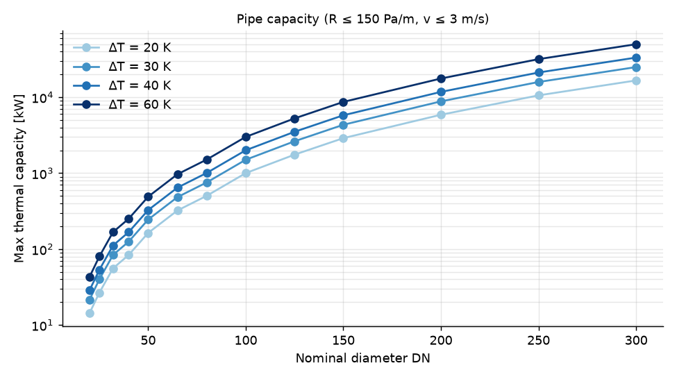

# Pipe sizing – method and assumptions

🇬🇧 English · module `src/dhnet/sizing.py`, ArcGIS version `arcpy/02_size_pipes.py`

The paper ([Strzalka, Malicki & Blachowski 2024](https://doi.org/10.3390/app14020763)) ends with:
*"Further directions of this study would be the development of a tool for dimensioning the heating pipes on the basis of the available heat demand data of individual heat consumers."*
This module is that next step. It was first built as an ArcGIS Pro ModelBuilder model ([`model/pipe_sizing.png`](../model/pipe_sizing.png)) for a follow-up article that was not published; here it is rewritten in Python with its own, documented capacity table.

## 1. Load on every pipe segment

1. Every connected building has a peak heat load `P_i` [kW] (field `peak_kw`).
2. The generated network is a tree, so there is exactly one path from the heat plant to each building. The path is found with Dijkstra (ModelBuilder: Closest Facility from the plant to every building).
3. Every segment on that path gets `+1` consumer and `+P_i` kW (ModelBuilder: Split Line At Vertices, then Dissolve with `SUM` of energy).

## 2. Simultaneity (diversity) factor

Buildings do not all reach their peak at the same moment, so the summed load of `n` downstream consumers is reduced:

```
P_design = g(n) · Σ P_i
g(n) = 0.449245 + 0.550755 / (1 + (n / 53.84) ^ 1.7609)
```

after Winter, Haslauer & Obernberger (2001), *Untersuchungen der Gleichzeitigkeit in kleinen und mittleren Nahwärmenetzen*, Euroheat & Power 9/2001 and 10/2001.

| n | 1 | 5 | 10 | 20 | 50 | 100 | 200 | 500 |
|---|---|---|---|---|---|---|---|---|
| g(n) | 1.00 | 0.99 | 0.97 | 0.92 | 0.74 | 0.59 | 0.50 | 0.46 |

The original ModelBuilder model summed the peak loads without this factor.

## 3. Capacity of a pipe

Thermal power carried by a pipe:

```
P = ṁ · c_p · ΔT          ṁ = ρ · v · π d_i² / 4
```

The highest allowed velocity `v` is the stricter of two design criteria:

- specific pressure loss `R ≤ R_max`, with `R = f · ρ v² / (2 d_i)` (Darcy–Weisbach) and `f` from Colebrook–White (laminar: `64/Re`);
- velocity `v ≤ v_max`.

| Parameter | Default | CLI flag |
|---|---|---|
| ΔT supply – return | 30 K | `--delta-t` |
| R_max | 150 Pa/m | `--max-dp` |
| v_max | 3 m/s | `--max-v` |
| Pipe roughness k | 0.05 mm | `DesignParameters.roughness_mm` |
| Water at ~70 °C | ρ = 977.8 kg/m³, c_p = 4.19 kJ/(kg·K), ν = 0.413·10⁻⁶ m²/s | `DesignParameters` |
| Inner diameters | steel service pipe of pre-insulated bonded pipes, EN 253 (outer diameter × standard wall) | `STEEL_INNER_DIAMETER_MM` |

### Resulting capacity table [kW]

| DN | d_i [mm] | ΔT 20 K | ΔT 30 K | ΔT 40 K | ΔT 60 K | v at capacity [m/s] |
|---|---|---|---|---|---|---|
| DN 20 | 21.7 | 14 | 22 | 29 | 43 | 0.48 |
| DN 25 | 27.3 | 27 | 40 | 53 | 80 | 0.56 |
| DN 32 | 36.0 | 56 | 84 | 112 | 168 | 0.67 |
| DN 40 | 41.9 | 84 | 126 | 167 | 251 | 0.74 |
| DN 50 | 53.9 | 163 | 245 | 327 | 490 | 0.87 |
| DN 65 | 69.7 | 323 | 484 | 645 | 968 | 1.03 |
| DN 80 | 82.5 | 504 | 756 | 1,008 | 1,511 | 1.15 |
| DN 100 | 107.1 | 1,002 | 1,504 | 2,005 | 3,007 | 1.36 |
| DN 125 | 132.5 | 1,755 | 2,632 | 3,509 | 5,264 | 1.55 |
| DN 150 | 160.3 | 2,894 | 4,340 | 5,787 | 8,681 | 1.75 |
| DN 200 | 210.1 | 5,881 | 8,822 | 11,762 | 17,643 | 2.07 |
| DN 250 | 263.0 | 10,585 | 15,877 | 21,169 | 31,754 | 2.38 |
| DN 300 | 312.7 | 16,639 | 24,958 | 33,277 | 49,916 | 2.64 |

With these defaults the pressure-loss limit is always the stricter one; `v_max` only matters if you raise `R_max`.



**Selection:** the smallest DN whose capacity covers `P_design` of the segment.

## 4. Limits – read before using the numbers

- This is a **pre-design / feasibility** tool for the first draft of a network, not a hydraulic calculation. There is no pressure balance over the whole network, no heat losses, no pump sizing and no check of the critical consumer.
- A single R_max for all pipes is a simplification. Designers often allow higher R in short service pipes and lower R in long mains. The table is rather **conservative** (it picks larger pipes than many design tools) for small DN; change `R_max` to match your own design rules.
- Peak loads must come from your own heat demand model (e.g. building type × floor area × specific demand). The sample data uses synthetic values.
